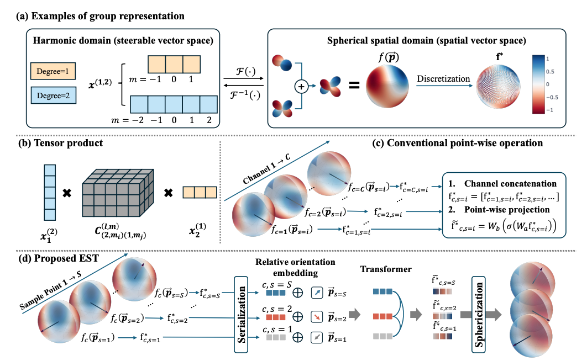

# Equivariant Spherical Transformer for Efficient Molecular Modeling

[](LICENSE)

Official PyTorch implementation of the NeurIPS 2026 paper **“Equivariant Spherical Transformer for Efficient Molecular Modeling”** ([paper PDF](5978_Equivariant_Spherical_Tra.pdf)).

## EST at a Glance

**EST is a plug-and-play update module for equivariant molecular networks.** It projects steerable features onto sampled spherical orientations, applies Transformer attention across orientations, and maps the result back to irreducible representations. Existing message-passing backbones can therefore keep their graph construction, edge features, and prediction heads while adding EST as an expressive parallel branch.

- **Drop-in integration:** insert `NodeEST` into a node-update block or `EdgeEST` into an edge-message block.
- **Backbone agnostic:** the paper evaluates EST with Equiformer, EquiformerV2, SCN-style updates, and other equivariant architectures.
- **Hybrid by design:** an exactly equivariant steerable branch can run beside the sampled spherical EST branch.
- **Minimal tuning:** the main EST-specific choices are the spherical sampling resolution and the numbers of steerable/spatial experts.

<p align="center">
  
</p>

## Plug-and-Play Usage

The reusable implementation lives in [`EST_nets/`](EST_nets). The smallest integration adds EST to an existing update block whose features have shape `[num_nodes, (lmax + 1)^2, channels]`:

```python
from EST_nets import NodeEST, ToS2Grid_block

grid = ToS2Grid_block(l=lmax, res=64)
est_update = NodeEST(
    lmax=lmax,
    channels=channels,
    to_grid=grid,
    num_experts=1,
)

# Inside an existing equivariant layer:
base_out = base_update(x)      # keep the original steerable path
est_out = est_update(x)        # add cross-orientation attention
x = x + base_out + est_out
```

For edge-message integration, use `EdgeEST` with the same spherical grid:

```python
from EST_nets import EdgeEST

est_message = EdgeEST(
    lmax=lmax,
    channels=channels,
    to_grid=grid,
    spherical_num_experts=1,
    edge_info=True,
)

message = message + est_message(message, edge_spherical_harmonics)
```

`NodeEST` and `EdgeEST` accept optional invariant expert weights. See [`EST_nets/est_layers.py`](EST_nets/est_layers.py) for the dense hybrid-expert integration used by the standalone EST architecture, and [`nets/graph_attention_transformer.py`](nets/graph_attention_transformer.py) for the Equiformer integration.

> EST uses finite spherical sampling and is approximately equivariant. Keeping the original exactly equivariant branch in parallel provides a practical balance between equivariance and expressiveness.

## Available Implementations

| Implementation | Intended use | Location |
|---|---|---|
| Core EST modules | Add EST to a custom equivariant backbone | [`EST_nets/`](EST_nets) |
| EST + Equiformer | QM9 and OC20 IS2RE experiments | [`nets/graph_attention_transformer.py`](nets/graph_attention_transformer.py) |
| EST + EquiformerV2 | OC20 S2EF and MPtrj integration for FairChem | [`equiformerv2-EST/`](equiformerv2-EST) |

The standalone package also exposes complete reference models:

```python
from EST_nets import EquivariantSphericalTransformer, est_4layer, est_6layer

model = est_6layer()
```

## Environment Setup

Create the provided Conda environment:

```bash
conda env create -f env/env_est.yml
conda activate est
export PYTHONNOUSERSITE=True
```

Additional OC20 and FairChem setup is documented in [`docs/env_setup.md`](docs/env_setup.md).

### Datasets

- **QM9:** downloaded automatically on the first training run.
- **OC20:** follow the FairChem dataset instructions and update the dataset paths in the corresponding YAML files.
- **MPtrj:** follow the Materials Project MPtrj documentation and configure the dataset path in FairChem.

## Reproducing Experiments

### QM9: EST + Equiformer

```bash
sh scripts/train/qm9/equiformer/target@1.sh
```

Entry point: [`main_qm9.py`](main_qm9.py).

### OC20 IS2RE: EST + Equiformer

```bash
sh scripts/train/oc20/is2re/graph_attention_transformer/l1_256_nonlinear_split@all_g@2.sh
```

Entry point: [`main_oc20.py`](main_oc20.py).

### OC20 S2EF / MPtrj: EST + EquiformerV2

Copy or symlink [`equiformerv2-EST/`](equiformerv2-EST) into the model directory of the pinned FairChem setup, then launch training through FairChem using the corresponding EquiformerV2 configuration. See [`docs/env_setup.md`](docs/env_setup.md).

## Repository Layout

```text
EST_nets/            Reusable EST blocks and standalone reference models
nets/                EST + Equiformer implementation
equiformerv2-EST/    EST + EquiformerV2 implementation
oc20/                OC20 trainers and configurations
scripts/             Reproduction scripts
docs/                Environment and model-selection notes
```

## Core API

- `ToS2Grid_block`: Fibonacci-lattice sampling and transforms between irreducible and spherical spatial representations.
- `NodeEST`: node-wise EST update; query, key, and value come from aggregated node features.
- `EdgeEST`: edge-wise EST message block; query/value come from messages and key can use relative-position spherical harmonics.
- `EST_update`: hybrid steerable/spatial update block with invariant gates.
- `EST_layer`: complete message-and-update layer for the standalone architecture.

Hyperparameters and tensor conventions are summarized in [`EST_nets/README.md`](EST_nets/README.md).

## License

This project is released under the [MIT License](LICENSE).
